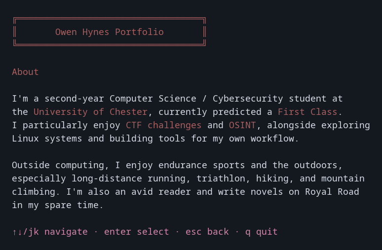

# SSH Portfolio

An interactive terminal portfolio served over SSH. Built with Go, Wish, Bubble Tea and Lip Gloss.



Browse About, Projects, Research & Experience, Skills and Contact without leaving your terminal. This is a working prototype; the portfolio content currently lives in `cmd/main.go`.

## Run locally

Requires Go 1.27.1 or newer and an SSH client.

```sh
git clone https://github.com/meanybeany420/ssh-portfolio.git
cd ssh-portfolio
go run ./cmd
```

In another terminal:

```sh
ssh -p 23234 visitor@127.0.0.1
```

The server binds to localhost by default. It generates its own host key at `.ssh/id_ed25519`; that directory is ignored by Git. Keep the key private and reuse it between starts to preserve the server's identity. The initial SSH host-key confirmation is expected when connecting for the first time.

To build a binary:

```sh
go build -o bin/ssh-portfolio ./cmd
./bin/ssh-portfolio
```

## Controls

| Key | Action |
| --- | --- |
| `↑` / `k` | Previous section |
| `↓` / `j` | Next section |
| `Enter` | Open section |
| `Esc` | Return to menu |
| `q` / `Ctrl+C` | Close your session |

The server stays running when a visitor quits. Press `Ctrl+C` in the server terminal to shut it down.

## Configuration

```sh
./bin/ssh-portfolio -listen 127.0.0.1:2222 -host-key .ssh/portfolio_key
```

| Flag | Default | Purpose |
| --- | --- | --- |
| `-listen` | `127.0.0.1:23234` | Listening address and port |
| `-host-key` | `.ssh/id_ed25519` | Persistent server host-key file |

`-h` lists the available flags. Relative key paths are resolved from the directory where the server starts. If you choose another key location, keep it outside Git or add an ignore rule first.

## Checks

```sh
go mod verify
go test -race ./...
go vet ./...
go run golang.org/x/vuln/cmd/govulncheck@v1.9.0 ./...
python3 scripts/smoke_test.py
```

The smoke test requires Python 3 and the OpenSSH client on Linux or macOS. It starts an isolated localhost server on an OS-assigned port, generates temporary keys, connects through a real PTY, navigates the portfolio and checks session exit and server shutdown. It does not use your existing host keys or SSH identities.

GitHub Actions runs the checks and builds the server.

## Current limitations

- Content is compiled into the application rather than loaded from a separate file.
- Long pages do not scroll, and the layout is not yet responsive to terminal resizing. Use a reasonably wide terminal; the preview was captured at 120 × 40.
- Visitors are not authenticated. That is intentional for read-only portfolio access, not a basis for private communication or remote administration.
- Public internet deployment has not been hardened or load-tested. Keep the default localhost binding until connection limits, timeouts and deployment isolation have been addressed.

## Next

- Responsive layout and scrolling.
- Separate portfolio content from rendering.
- Deployment hardening before public hosting.

## License

MIT. See [LICENSE](LICENSE).
